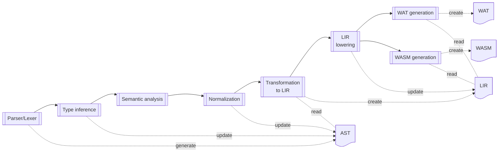

# Compiler Pipeline

The Capylang compiler currently follows a small number of explicit passes from
source text to WebAssembly output.

## Overview

This is the current logical pipeline. Individual implementation details may
still move while the compiler grows, but these stages describe the existing
compiler structure.

## Parser

The parser consumes lexer tokens and constructs the AST used by later stages.
At this stage the compiler preserves source-level structure, including syntactic
sugar that is still convenient for later semantic work.

## Type Inference

Type inference resolves types that are introduced implicitly by variables,
expressions, and blocks. The pass is responsible for turning partially typed
program fragments into a form where later checks can rely on explicit type
information.

## Semantic Analysis

Semantic analysis verifies that the program is internally consistent after type
inference. In particular, it checks that:

1. No unknown types remain unresolved.
2. `if` branch result types agree with each other and with the target type.
3. Assignment source and destination types match.
4. Returned values match the enclosing function signature.

## Normalization

Normalization removes source-level special cases that would otherwise leak into
lowering and code generation. The current normalizations include:

 * Converting a final expression without a trailing semicolon into an explicit
  `return` expression.
 * Add explicit pointer dereferencing nodes for record field accesses where they
  are missing and where the field access is on a pointer to a record

This stage is where additional syntactic sugar should be lowered into more
uniform internal forms.

## Transformation to LIR

The normalized and type resolved AST is converted into a language-specific
intermediate representation, short LIR. This representation is chosen to
simplify the generation for some of the WASM language constructs and mainly
turns let-statements and assignment expressions into corresponding load 
expressions and store statements.

## LIR Lowering

Similar to the "Normalization" step for the AST, "LIR Lowering" transforms some
of the more higher level LIR node types into lower level constructs. The current
lowerings include:

 * Convert store_record_statements into multiple store_statement which set the
   individual fields of the record according to the initialisation list

## WASM IR Emission

After semantic work is complete, the compiler emits an internal representation
that is close enough to WebAssembly to support backend code generation.

Today this stage is described at a high level only. As the internal IR becomes
more stable, this section should be expanded with details about the emitted
structures, ownership of type information, and lowering conventions.

## WAT and WASM Generation

The final backend stages turn the lowered representation into textual WAT and
binary WASM output. Both backends are part of the supported compiler surface and
need to remain aligned when new language features are added.
